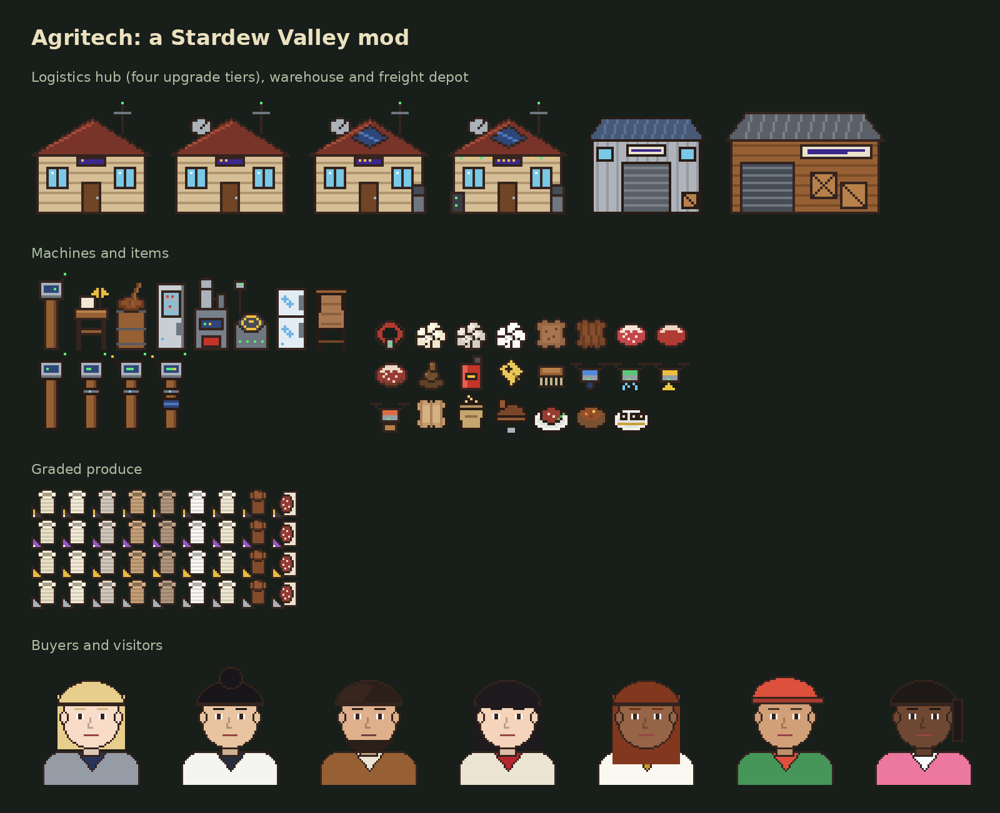

# Agritech for Stardew Valley



Agritech turns a Stardew Valley farm into an agritech business. It's a single C# mod for Stardew Valley 1.6 that adds a modern farm-technology layer on top of the base game: a tech Hub and its own skill, soil sensors and smart collars, new livestock breeds, leather and Wagyu production chains, luxury grading with provenance certificates, contracts with fashion houses and restaurants, freight logistics with perishable goods, waste-to-fuel energy, drones, a horse herd, and buyers who visit your farm.

Vanilla Stardew sells anything through the shipping bin at a fixed price. Agritech adds a second economy beside it: grade your goods, build relationships with buyers, meet deadlines and minimum grades, choose how to ship, and keep perishables cold on the way.

| Game | Framework | Dependencies | Version |
| --- | --- | --- | --- |
| Stardew Valley 1.6.15 | SMAPI 4.0+ (built against 4.5.2) | none required | 0.4.5 |

## Features

### The Hub and the Agritech skill
Build an **Agritech Hub** from Robin (four tiers) and level a dedicated **Agritech skill** from 0 to 10. You earn XP by collaring animals, grading goods, grooming, drone work, hosting buyers and delivering contracts. Each level unlocks recipes, breeds, buildings and buyers. Each Hub tier widens what the farm can see and do: soil readings, health tracking, the heat-map overlay, virtual fences, drones, forecasts and certified top grades.

### Sensors, collars and the farm terminal
- **Sensor Posts** read soil moisture and nutrients around them; nutrients drain under crops and recover when the ground is fallow or fertilised.
- **Smart Collars** track each animal's health, production and heat cycle.
- The **farm data terminal** (F8, or click the Hub) lays it all out on a green-screen monitor, and a **heat-map overlay** (F9) colours your fields by soil state.
- **Virtual fences** (F10/F11): draw zones, and a herding drone walks collared animals into the active one.

### Breeds
**Merino sheep, Cashmere goats, Angora rabbits and Wagyu cattle**, sold by Marnie as your skill grows, plus a **horse herd** (bay, black, grey) that lives in the barn, breeds there, eats Oat Feed, gets groomed, and can be saddle-trained to sell for double.

### Production chains
- **Fibre:** raw wool, cashmere and angora → **Grading Table** → Fine, Prime, Estate or Couture lots. The grade comes from input quality, collared-herd health and your skill. Every lot carries a **provenance certificate** in its tooltip.
- **Leather:** Butcher's Tag → Raw Hide → **Drying Rack** → **Tanning Vat** → Tanned Leather → graded.
- **Wagyu:** Wagyu cut → **Ageing Locker** (3 days) → Dry-Aged Wagyu → graded; plus Wagyu Steak, Beef Stew and Wagyu Tasting as cooking recipes.
- **Waste to energy:** barns produce manure → **Fischer-Tropsch Unit** → Synthetic Fuel → trucks, drones, or a Fuel Cell for battery packs.

### Trade and logistics
- Fashion houses (Paris, Milan, Stockholm), restaurants in Zuzu City, and Gus and Emily post **contracts** every Monday with quantities, deadlines and minimum grades (F7, or click the Freight Depot).
- Relationships grow with on-time deliveries and farm visits: bigger orders, higher grades, then **standing orders**.
- **Shipping:** cart, rail, truck (burns fuel) or air, each trading speed against cost. Meat and milk have a **shelf life**; late deliveries pay 70%, spoiled ones pay half. Keep goods cold with a **Cold Store** or the **Cold Warehouse**.
- Buyers **visit the farm** on their day each season to inspect your collared herd; tourists come on weekends and pay for a tour.

### Drones
Place a **Drone Dock** with a chest beside it, stocked with drones and battery packs or fuel. Every morning: **Survey** (sensor coverage for the whole farm), **Spray** (fertilises and waters), **Herding** (enforces virtual fences) and **Delivery** (ships contracts straight from the chest). Docked drones hover over the dock.

The full in-game guide, with unlock levels and every recipe, is in [`Agritech/README.md`](Agritech/README.md).

## Install

1. Install [SMAPI](https://smapi.io).
2. Download the latest `Agritech-x.y.z.zip` from [Releases](../../releases) and unzip it into `Stardew Valley/Mods`.
3. Launch the game through SMAPI.

**Keys** (changeable in `config.json`): F7 contract board · F8 terminal · F9 overlay · F10 draw fence zone · F11 cycle zones.
**Console** (SMAPI window): `agritech` shows your skill level and XP; `agritech_xp <amount>` adds XP for testing; `agritech_selftest run` (on a throwaway save) drives every feature once and prints PASS/FAIL for each check.

**Balance diary:** while you play, the mod writes one line per in-game day to `Mods/Agritech/balance/<save>.csv` (skill progress, where XP came from, contract income next to shipping-bin income), so balance can be judged from real play.

## Works with (optional)

Agritech runs on its own. If these mods are installed, it links into them:

| Mod | What Agritech does with it |
| --- | --- |
| Cloths and Colors (selph) | Its spinner and loom take Merino wool, raw cashmere and raw angora; its Sewing skill boosts fibre grading, and grading earns Sewing XP. Its own cashmere and silk can be graded. |
| Mizu's Alpaca & Llama | Alpaca and llama wool can be graded, and fashion houses order it. |
| Tractor Mod (Pathoschild) | The tractor burns Synthetic Fuel, or coal as a fallback. |
| Automate (Pathoschild) | Agritech machines use the game's machine system, so Automate can feed them. |

## Known issues

- Milk moved by Automate never spoils.
- You can't gift Gus or Emily an item they have an open order for: clicking them counts as a delivery.
- The horse herd, Drying Rack, Cold Warehouse, the new dishes and the drones pass `agritech_selftest` (80 of 80 checks), but haven't had a full in-game playthrough yet. Bug reports are welcome in [Issues](../../issues).

## Building from source

Requirements: the [.NET 6 SDK](https://dotnet.microsoft.com/download) or newer, and Stardew Valley with SMAPI installed.

```
cd Agritech
dotnet build -c Release
```

The build uses [Pathoschild.Stardew.ModBuildConfig](https://www.nuget.org/packages/Pathoschild.Stardew.ModBuildConfig), which finds your game folder, references the game and SMAPI from it, and copies the built mod into `Mods/Agritech`. To point at a specific install, set `GamePath` in `Agritech/Agritech.csproj`.

## Project layout

```
Agritech/
  ModEntry.cs         entry point: events, input, terminal, overlay
  ContentRegistry.cs  items, machines, recipes, buildings and textures added to the game data
  Ids.cs              item IDs, materials and grading tiers
  Skill.cs            the Agritech skill, levels and unlocks
  FarmData.cs         Hub tier, sensors, soil and animal readings
  Machines.cs         Grading Table and ageing logic
  Contracts.cs        buyers, goods, contracts, shipping and cold chain
  ContractsMenu.cs    the contract board
  TerminalMenu.cs     the farm data terminal
  Drones.cs           Drone Dock and morning flights
  Livestock.cs        breeds, retiring animals, manure, riding horse care
  Herd.cs             the horse herd: care, training, sale price
  HorseArt.cs         builds the herd horse sprites from the game's horse at load time
  Visitors.cs         visiting buyers and tourists
  Polish.cs           tooltips, herding, tractor fuel, hand delivery
  Integration.cs      Cloths and Colors / SpaceCore link
  SelfTest.cs         agritech_selftest: drives every feature once and reports PASS/FAIL
  BalanceDiary.cs     the daily balance diary
  SaveModel.cs        everything stored in the save
  assets/             original art: items, machines, Hub tiers, buildings, buyers and portraits
```

## Credits

Created by Ali ([@AlimuzammilH](https://github.com/AlimuzammilH)): concept, systems and economy design, art direction, integration with other mods, and in-game testing. Developed with AI-assisted programming (Claude by Anthropic).

Thanks to Pathoschild for SMAPI and ModBuildConfig, and to the authors of Cloths and Colors, SpaceCore and Mizu's Alpaca & Llama, whose mods Agritech links into.

## License

[MIT](LICENSE) for the code and the original art in `Agritech/assets`.

Agritech contains no game code or game art. The new breeds and the herd horses are recoloured from the game's own sprites at load time, inside your game. Stardew Valley is © ConcernedApe. This project is not affiliated with or endorsed by ConcernedApe.
